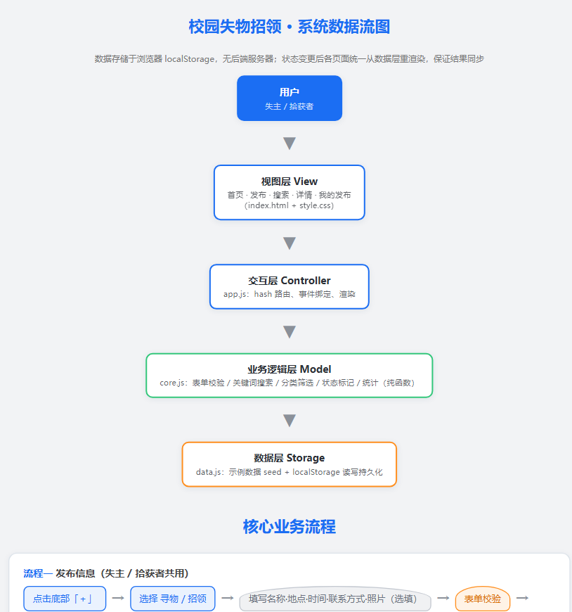
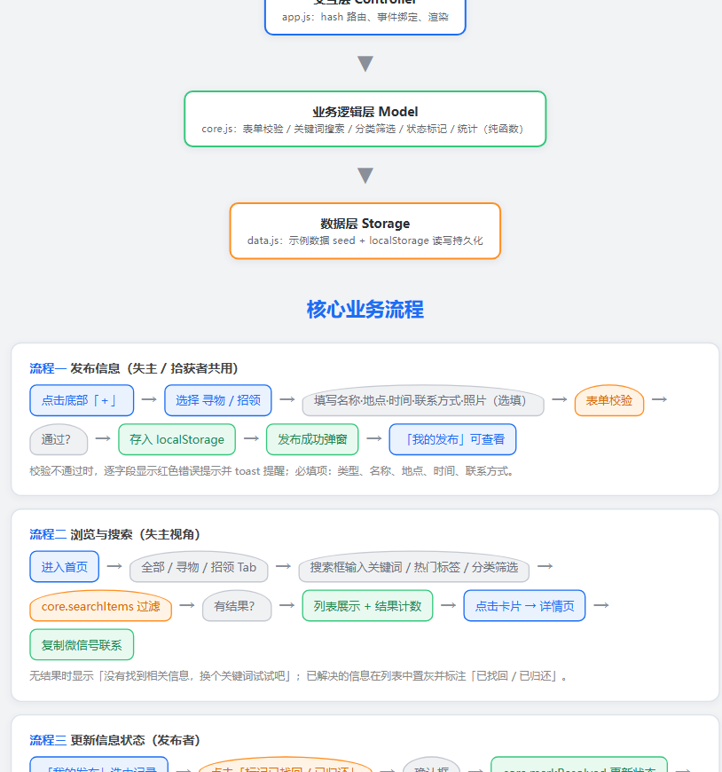
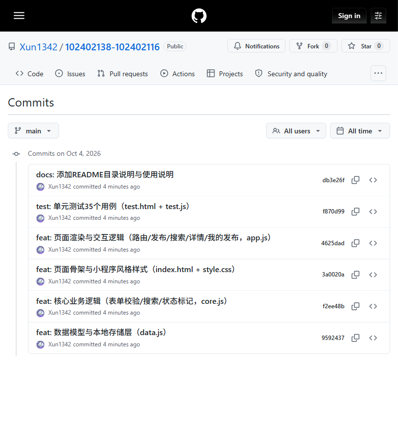
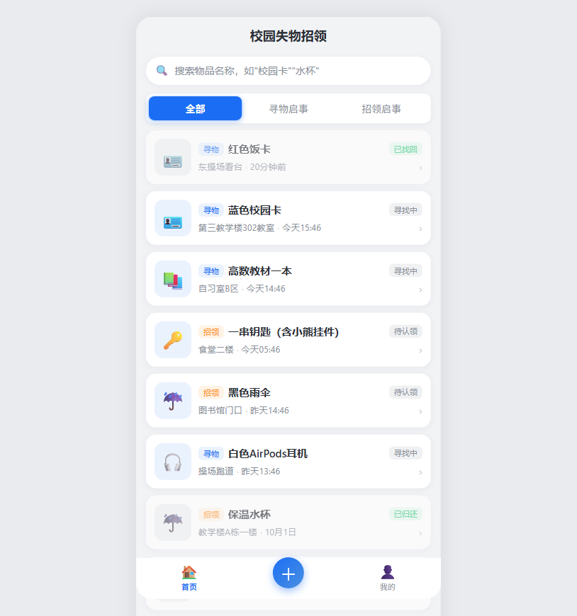
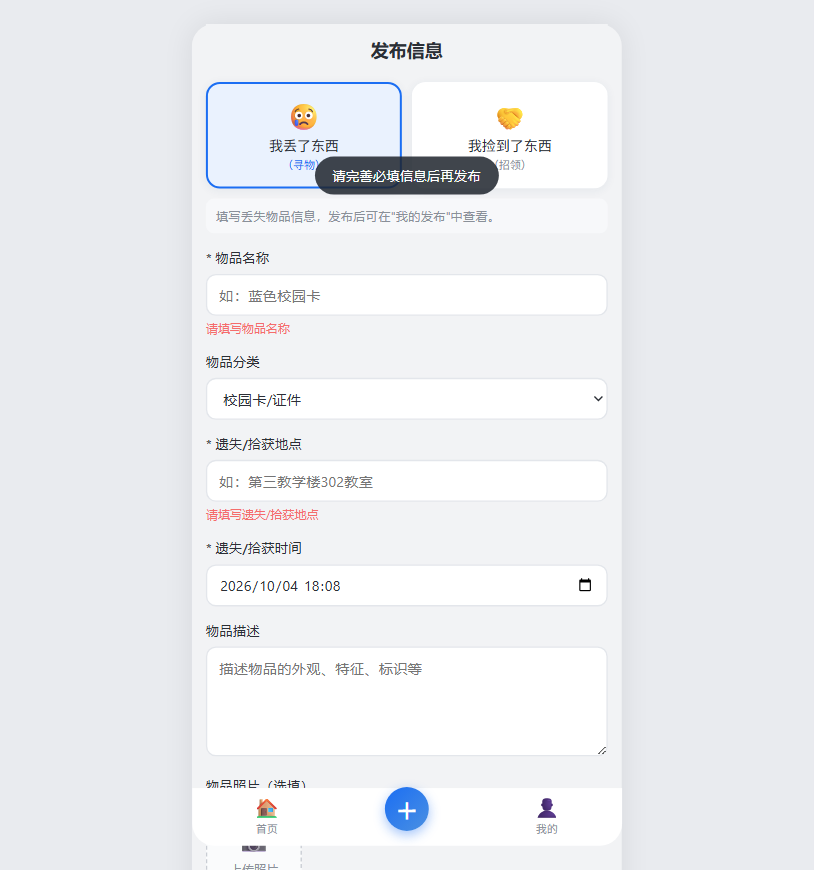
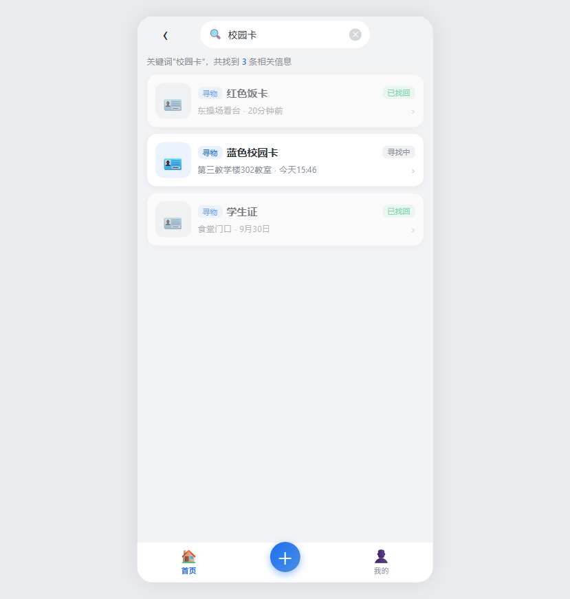
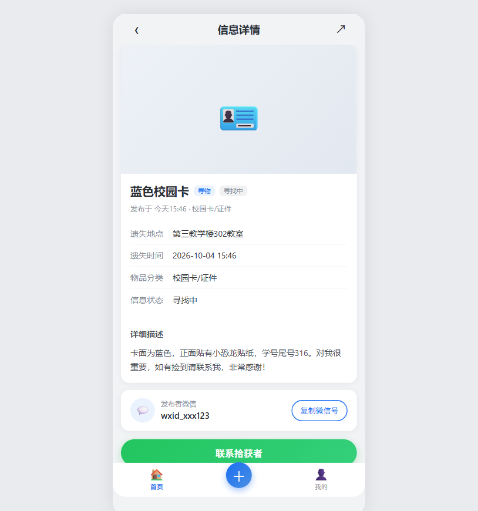
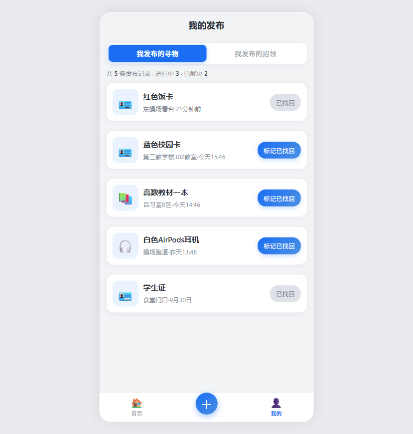
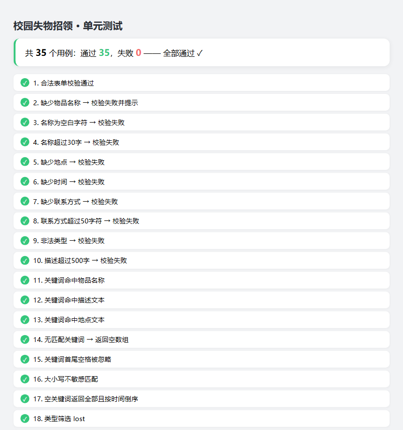

# 2026秋软件工程结对作业（第二次）——校园失物招领小程序程序实现

| 课程 | H202601软件工程与软件工程实践 |
|---|---|
| 作业要求 | [2026秋软件工程结对作业（第二次之程序实现）](https://edu.cnblogs.com/campus/fzu/2026-01SoftwareEngineeringandSoftwareEngineeringPractice/homework/16745) |
| 结对博客 | [蔡靖熹 的结对作业博客链接【待补充】]() |
| 本作业博客 | 【发布后补充本页链接】 |
| GitHub 仓库 | <https://github.com/Xun1342/102402138-102402116> |
| 学号姓名 | 102402116 蔡靖熹；102402138 吴政迅 |
| 原型链接 | [墨刀原型（第一次结对作业）](https://modao.cc/ai/share/6ab8dd7275d0275ef6fef497?pvp=mobile) |

> 已在班级群结对表格中填写本项目 GitHub 地址。

---

## 一、具体分工

| 成员 | 分工 |
|---|---|
| 蔡靖熹（102402116） | 需求梳理与功能范围界定；数据模型与核心业务逻辑设计（`data.js` / `core.js` 思路）；表单字段与校验规则制定；PSP 记录；博客整体架构 |
| 吴政迅（102402138） | 页面结构与样式实现（`index.html` / `style.css`）；页面交互与路由实现（`app.js`）；单元测试设计与执行；GitHub 仓库管理与代码签入；博客撰写与排版 |

两人共同完成：功能走查、问题排查、博客校对。

## 二、PSP 表格

| PSP2.1 | Personal Software Process Stages | 预估耗时（分钟） | 实际耗时（分钟） |
|---|---|---|---|
| Planning | 计划 | 30 | 25 |
| Estimate | 估计这个任务需要多少时间 | 10 | 10 |
| Development | 开发 | | |
| Analysis | 需求分析（包括学习新技术） | 40 | 35 |
| Design Spec | 生成设计文档 | 30 | 25 |
| Design Review | 设计复审 | 15 | 10 |
| Coding Standard | 代码规范（为目前的开发制定合适的规范） | 10 | 5 |
| Design | 具体设计 | 40 | 30 |
| Coding | 具体编码 | 120 | 155 |
| Code Review | 代码复审 | 20 | 15 |
| Test | 测试（自我测试，修改代码，提交修改） | 60 | 80 |
| Reporting | 报告 | | |
| Test Report | 测试报告 | 20 | 25 |
| Size Measurement | 计算工作量 | 10 | 5 |
| Postmortem & Process Improvement Plan | 事后总结，并提出过程改进计划 | 20 | 25 |
| **合计** | | **425** | **445** |

**PSP 说明**：实际编码与测试均超出预估约 35 分钟，原因是实现过程中发现并修复了「我的发布」中标记按钮与卡片跳转的事件委托冲突、照片压缩后体积控制等问题，这些排查返工没有在预估时考虑充分；文档类环节（设计、复审）实际耗时低于预估，说明原型阶段已经把页面结构想得比较清楚。

## 三、解题思路描述与设计实现说明

### 3.1 代码实现思路（文字描述）

**需求回顾**：基于第一次结对作业的墨刀原型，在 WEB 上实现「发布寻物/招领 → 集中浏览 → 关键词搜索 → 查看详情与联系方式 → 发布者标记已找回/已归还」的完整闭环，不实现登录、实名认证、聊天、地图。

**技术选型**：纯原生 HTML + CSS + JavaScript 静态网页。理由有三：

1. 作业要求"下载全部文件后用谷歌浏览器运行 html 即可展现预期结果"，零依赖、无环境是最稳妥的交付方式；
2. 数据量小（个人发布 + 浏览），用浏览器 localStorage 即可完成持久化，不需要后端，也不违反"不要求复杂后台"；
3. 原生 JS 便于把业务逻辑抽成纯函数，方便单元测试。

**架构分层**（MVC 思想）：

- `data.js`（数据层）：数据模型 + 示例数据（seed）+ localStorage 读写；
- `core.js`（业务逻辑层）：表单校验、关键词搜索、分类筛选、状态标记、统计等**纯函数**，不依赖 DOM，可单独测试；
- `app.js`（交互/控制器层）：hash 路由（`#/home` `#/publish` `#/search` `#/detail/:id` `#/mine`）、事件绑定、视图渲染；
- `index.html` + `style.css`（视图层）：单页应用五个视图 + 小程序风格样式。

**关键设计决策**：

- **状态闭环**：信息标记为"已找回/已归还"后写入 localStorage，首页、搜索、详情均从同一数据源渲染，保证"修改后其他用户在哪里看到结果"——这是上次作业点评中点名的流程缺口，本次在实现中补齐；
- **状态文案按类型区分**：寻物（寻找中 → 已找回）、招领（待认领 → 已归还），同一 `status` 字段，展示文案由 `core.statusText()` 统一计算；
- **异常路径全覆盖**：发布信息不完整逐字段红字提示、搜索无结果提示、列表为空提示——针对上次作业"不能只按一条顺利成功的路线设计产品"的反馈。

### 3.2 关键实现的流程图 / 数据流图

**系统数据流图**（分层架构与数据流转）：



**核心业务流程**（发布 / 浏览搜索 / 更新状态）：



### 3.3 重要代码片段及解释

**① 状态标记——纯函数，保证可测试、可回归**

`js/core.js` 中的 `markResolved`：返回新数组而不修改入参，重复标记幂等。这样首页/搜索/我的发布可以安全地基于新数组重渲染：

```javascript
function markResolved(items, id) {
  var list = Array.isArray(items) ? items : [];
  var changed = false;
  var next = list.map(function (item) {
    if (item.id === id && item.status !== 'resolved') {
      changed = true;
      return Object.assign({}, item, { status: 'resolved' });
    }
    return item;
  });
  return { items: next, changed: changed };
}
```

**② 关键词搜索——名称/地点/分类/描述多字段匹配**

`searchItems` 支持关键词 + 类型 + 分类组合过滤，并统一按发布时间倒序：

```javascript
function searchItems(items, keyword, type, category) {
  var result = (Array.isArray(items) ? items : []).filter(function (item) {
    if (type !== 'all' && item.type !== type) { return false; }
    if (category && item.category !== category) { return false; }
    if (!isKeywordMatch(item, keyword)) { return false; }
    return true;
  });
  result.sort(function (a, b) { return b.createdAt - a.createdAt; });
  return result;
}
```

**③ 表单校验——逐字段错误收集**

```javascript
function validatePublish(form) {
  var errors = {};
  if (TYPES.indexOf(form.type) === -1) { errors.type = '请选择信息类型（寻物/招领）'; }
  if (!form.name || !String(form.name).trim()) { errors.name = '请填写物品名称'; }
  else if (String(form.name).trim().length > 30) { errors.name = '物品名称不能超过30个字'; }
  if (!form.location || !String(form.location).trim()) { errors.location = '请填写遗失/拾获地点'; }
  if (!form.time) { errors.time = '请选择遗失/拾获时间'; }
  if (!form.contact || !String(form.contact).trim()) { errors.contact = '请填写联系方式（微信号）'; }
  return { ok: Object.keys(errors).length === 0, errors: errors };
}
```

**④ 数据持久化——localStorage 读写**

```javascript
function loadItems() {
  try {
    var raw = localStorage.getItem(STORAGE_KEY);
    if (raw) {
      var parsed = JSON.parse(raw);
      if (Array.isArray(parsed)) { return parsed; }
    }
  } catch (e) { /* localStorage 不可用或数据损坏，退回内存 */ }
  var seed = buildSeedItems();   // 首次打开生成示例数据
  try { localStorage.setItem(STORAGE_KEY, JSON.stringify(seed)); } catch (e) {}
  return seed;
}
```

## 四、附加特点设计与展示

### 4.1 设计的创意独到之处与意义【3 分】

- **意义**：把"联系之后信息如何结束"补完整——不是发布完就结束，而是发布者标记状态后，平台内所有展示位置同步更新，后续浏览者不再重复联系，真正减少无效沟通（针对上次作业点评点名的问题）；
- **零依赖交付**：整个项目不依赖任何 CDN、框架、后端，离线可跑，测试人员零成本复现（针对"页面画出来和用户能用是两回事"的反馈，我们把"能否用起来"做到了极致）；
- **数据不丢**：localStorage 持久化 + 示例数据兜底，刷新、关闭重开数据都在。

### 4.2 实现思路【3 分】

- **一键复制微信号**：优先使用 `navigator.clipboard`，失败降级到 `execCommand('copy')`，保证 file:// 协议下也能复制；
- **分类筛选 + 热门搜索标签**：搜索页提供 7 个物品分类标签与 7 个热门词标签，复用同一个 `searchItems` 过滤函数；
- **照片自动压缩**：`FileReader` 读图 → `<canvas>` 等比缩放到最长边 500px → `toDataURL('image/jpeg', 0.7)`，实测一张照片约 50~60KB，避免撑爆 localStorage 5MB 上限；
- **已解决置灰**：列表卡片对 `status === 'resolved'` 的信息降透明度并标注状态，状态一目了然。

### 4.3 重要代码片段及解释【2 分】

**照片自动压缩**（`app.js`）：

```javascript
function handlePhotoFile(file) {
  var reader = new FileReader();
  reader.onload = function (e) {
    var img = new Image();
    img.onload = function () {
      var maxSide = 500;
      var scale = Math.min(1, maxSide / Math.max(img.width, img.height));
      var w = Math.round(img.width * scale);
      var h = Math.round(img.height * scale);
      var canvas = document.createElement('canvas');
      canvas.width = w; canvas.height = h;
      canvas.getContext('2d').drawImage(img, 0, 0, w, h);
      var dataUrl = canvas.toDataURL('image/jpeg', 0.7);  // 压缩后存 localStorage
      currentPhoto = dataUrl;
      document.getElementById('photo-placeholder').innerHTML =
        '';
    };
    img.src = e.target.result;
  };
  reader.readAsDataURL(file);
}
```

**一键复制微信号（双通道降级）**：

```javascript
function copyText(text, tip) {
  function fallback() {
    var ta = document.createElement('textarea');
    ta.value = text; ta.style.position = 'fixed'; ta.style.opacity = '0';
    document.body.appendChild(ta);
    ta.select();
    try { document.execCommand('copy'); } catch (e) {}
    document.body.removeChild(ta);
  }
  function done() { showToast(tip || '已复制'); }
  if (navigator.clipboard && navigator.clipboard.writeText) {
    navigator.clipboard.writeText(text).then(done, function () { fallback(); done(); });
  } else { fallback(); done(); }
}
```

### 4.4 实现成果展示【2 分】

**首页**：搜索入口 + 全部/寻物/招领 Tab + 信息卡片列表，已解决信息置灰并标注状态。

**发布页**：寻物/招领类型切换 + 必填校验（空表单提交会逐字段红字提示）+ 照片上传压缩 + 发布成功弹窗。

**搜索页**：热门标签 + 分类筛选 + 结果计数 + 无结果友好提示。

**详情页**：地点/时间/分类/描述 + 发布者微信号 + 一键复制。

**我的发布**：寻物/招领 Tab + 统计（共 N 条·进行中·已解决）+ 标记已找回/已归还（带确认框，防误触）。

（以上各页面截图见文末"成果截图"区，均为 Chrome 实际走查结果。）

## 五、目录说明和使用说明

### 5.1 目录组织【2.5 分】

```
campus-lost-found/
├── index.html          # 主页面（单页应用：首页/发布/搜索/详情/我的发布）
├── css/
│   └── style.css       # 全部样式（小程序风格，移动端居中、响应式）
├── js/
│   ├── data.js         # 数据模型 + 示例数据 + localStorage 读写
│   ├── core.js         # 核心业务逻辑（校验/搜索/状态标记/统计，纯函数）
│   └── app.js          # 页面渲染、路由与交互逻辑
├── test/
│   ├── test.html       # 单元测试运行页面
│   └── test.js         # 35 个单元测试用例（白盒为主）
├── docs/               # 博客素材（流程图、截图）
└── README.md           # 目录说明与使用说明
```

说明：页面、样式、脚本按职责分目录；`core.js` 刻意与 DOM 解耦（纯函数），保证可单测；不使用任何第三方框架，无 CDN 依赖。

### 5.2 测试人员如何运行【2.5 分】

1. 从 GitHub 仓库下载全部文件（保持目录结构不变）；
2. 用**谷歌浏览器（Chrome）** 打开 `index.html`，即可使用全部功能；
3. 单元测试：用 Chrome 打开 `test/test.html`，页面直接显示用例执行结果。

无需安装任何环境、无需联网。数据保存在浏览器 localStorage 中，关闭页面再打开记录仍在。

## 六、单元测试

### 6.1 选用的测试工具、学习过程与简易教程【4 分】

**工具**：自研轻量断言框架（约 20 行），不依赖 Mocha/Jest 等第三方库。

**为什么这样选**：项目本身零依赖交付，若引入 Mocha 需要 node 环境或额外引入测试框架文件，会增加测试人员复现成本；自写断言函数 + 浏览器直接运行，最贴合"下载后 Chrome 打开即用"的交付约束。

**学习过程**：参考邹欣老师《关于单元测试和回归测试》理解"单元测试自动化、可回归"的思想，阅读廖雪峰 JavaScript 教程掌握基础语法，学习白盒测试的分支覆盖思路（正常分支、边界分支、异常分支都要测）。

**简易教程（三步学会运行）**：

1. 用 Chrome 打开 `test/test.html`；
2. 页面自动加载被测模块（`../js/data.js`、`../js/core.js`）并执行 `test.js`；
3. 顶部汇总显示"共 N 个用例：通过 X，失败 Y"，下方逐条列出每个用例的通过/失败与失败原因。

断言框架核心（`test.js`）：

```javascript
var passed = 0, failed = 0;
function run(name, fn) {
  try { fn(); passed++; log(name, true); }
  catch (e) { failed++; log(name, false, e.message); }
}
function assert(cond, msg) {
  if (!cond) { throw new Error(msg || '断言失败'); }
}
function assertEqual(actual, expected, msg) {
  if (actual !== expected) {
    throw new Error((msg || '值不相等') + '：期望 [' + expected + ']，实际 [' + actual + ']');
  }
}
```

### 6.2 部分单元测试代码及说明【3 分】

针对 `core.js` 的 4 个核心函数共 35 个用例，下面展示两类：

**校验分支**（正常 / 空值 / 空白字符 / 超长 / 非法类型）：

```javascript
run('1. 合法表单校验通过', function () {
  assert(Core.validatePublish(validForm()).ok === true);
});
run('3. 名称为空白字符 → 校验失败', function () {
  var f = validForm(); f.name = '   ';
  var r = Core.validatePublish(f);
  assertEqual(r.ok, false);
  assert(!!r.errors.name);
});
run('9. 非法类型 → 校验失败', function () {
  var f = validForm(); f.type = 'hack';
  var r = Core.validatePublish(f);
  assertEqual(r.ok, false);
  assert(!!r.errors.type);
});
```

**状态标记幂等性与纯函数性**：

```javascript
run('24. 重复标记为幂等操作', function () {
  var list = [makeItem({ id: 'z', status: 'resolved' })];
  var r = Core.markResolved(list, 'z');
  assertEqual(r.changed, false);            // 已解决不再变更
});
run('25. markResolved 不修改原数组（纯函数）', function () {
  var list = [makeItem({ id: 'p' })];
  var snapshot = JSON.stringify(list);
  Core.markResolved(list, 'p');
  assertEqual(JSON.stringify(list), snapshot);  // 原数组未被改动
});
```

### 6.3 构造测试数据的思路与对测试人员"刁难"的考虑【3 分】

**构造思路（白盒为主，覆盖三分支）**：

- **正常分支**：合法表单、存在的关键词（命中名称/描述/地点）、正确的状态文案；
- **边界分支**：空字符串、首尾空格、大小写（`AirPods` vs `airpods`）、30/50/500 字长度上限、空关键词返回全部且倒序、重复标记幂等；
- **异常分支**：缺必填字段、非法类型（`'hack'`）、不存在的 id、无匹配关键词、无效时间戳。

**对测试人员"刁难"的考虑**：

- 输入超长文本 → 校验拦截（名称 ≤30、联系方式 ≤50、描述 ≤500）；
- 输入全空格 → `trim()` 后判空拦截；
- 输入不存在关键词 → 返回空数组，页面显示"没有找到相关信息，换个关键词试试吧"，不报错；
- 重复点击"标记已找回" → 幂等处理 + 已解决按钮置灰禁用，不会重复修改；
- 刷新/关闭重开 → localStorage 数据不丢失；
- 图片超大 → 限制 8MB 并自动压缩，避免存储超限；
- 测试数据使用独立构造函数 `makeItem()` 生成，不污染真实 localStorage 数据。

**自评**：35 个用例覆盖了核心函数的正常、边界、异常三类分支，能够满足本项目"正确发布、准确搜索、状态可靠更新"的测试要求；测试框架可随时在浏览器运行，具备自动化与可回归特性。

## 七、GitHub 代码签入记录【1 分】

按功能模块划分提交（每完成一个功能模块编译通过后 commit 一次）：



| 提交信息 | 功能模块 |
|---|---|
| feat: 数据模型与本地存储层（data.js） | 数据层 |
| feat: 核心业务逻辑（表单校验/搜索/状态标记，core.js） | 业务逻辑层 |
| feat: 页面骨架与小程序风格样式（index.html + style.css） | 视图层 |
| feat: 页面渲染与交互逻辑（路由/发布/搜索/详情/我的发布，app.js） | 交互层 |
| test: 单元测试35个用例（test.html + test.js） | 单元测试 |
| docs: 添加README目录说明与使用说明 | 文档 |

GitHub 仓库：<https://github.com/Xun1342/102402138-102402116>

## 八、遇到的代码模块异常或结对困难及解决方法【4 分】

### 问题一：标记按钮点击误跳详情页

| 项目 | 内容 |
|---|---|
| 问题描述 | 「我的发布」中点击"标记已找回/已归还"按钮，页面却跳转到该条信息详情页，标记流程被打断 |
| 做过哪些尝试 | ① 复查事件绑定，确认两个 click 监听器都挂在列表容器上；② 打印事件目标，发现按钮位于卡片内部，卡片跳转监听器同样命中 |
| 是否解决 | 已解决。在卡片跳转监听器中排除按钮目标：`if (card && !e.target.closest('.btn-mark'))` |
| 有何收获 | 事件委托要特别注意"容器内的可点击子元素"与"容器跳转"的冲突；排查时先确认事件目标再动手改代码 |

### 问题二：file:// 协议下复制剪贴板不可靠

| 项目 | 内容 |
|---|---|
| 问题描述 | 本地 html 直接打开时，`navigator.clipboard.writeText` 在部分环境下失败，复制微信号无反馈 |
| 做过哪些尝试 | ① 尝试 `execCommand('copy')` 兜底；② 用隐藏 textarea + select 模拟复制 |
| 是否解决 | 已解决。采用"clipboard API 优先 + execCommand 降级"双通道，两种情况都给出 toast 反馈 |
| 有何收获 | 交付目标是"下载后直接打开"，所以必须考虑 file:// 协议的兼容性，不能假设 HTTPS 环境 |

### 问题三：照片上传导致 localStorage 超限风险

| 项目 | 内容 |
|---|---|
| 问题描述 | 原图 base64 过大时可能撑爆 localStorage 5MB 上限，导致保存静默失败 |
| 做过哪些尝试 | ① 限制文件大小 ≤8MB；② canvas 等比压缩至最长边 500px、JPEG 质量 0.7 |
| 是否解决 | 已解决。实测压缩后单张约 50~60KB，`saveItems` 增加返回值，保存失败时 toast 提醒 |
| 有何收获 | 数据持久化的"体积"是隐性约束，设计阶段就应考虑容量上限并做降级处理 |

## 九、评价你的队友【2 分】

### 蔡靖熹评价吴政迅

**值得学习的地方**：编码效率高，页面还原度好，把墨刀原型的五个页面原汁原味落地，还主动补上了表单校验、空状态等原型里没有的细节；对 git 提交时机把握规范，按功能模块提交便于回溯。

**需要改进的地方**：前期沟通时可以更早把交互细节（比如标记按钮点击范围）拿出来讨论，避免实现后返工；遇到问题时可以先口头同步再动手，减少重复排查。

### 吴政迅评价蔡靖熹

**值得学习的地方**：需求边界把控清晰，始终坚持"不做后台、不做聊天、不做地图"的范围纪律，把复杂度控制得很好；数据模型设计考虑到了状态幂等、纯函数可测等工程细节，为测试省了很多事。

**需要改进的地方**：分工后可以对代码实现部分投入更多，比如亲手跑一遍单元测试、体验一次完整发布流程，这样结对的意义会更完整。

---

## 附：成果走查截图（Chrome 实际运行）

**首页**



**发布页（含校验提示）**



**搜索页（含结果与无结果提示）**



**详情页（一键复制微信号）**



**我的发布（标记状态）**



**单元测试（35/35 通过）**


